# Métricas do Legado – SMART/ML (MCITools)

> Métricas extraídas por análise estática do repositório `NovaFase` (código Object Pascal, formulários `.dfm/.lfm`,
> banco `bd1.mdb` e fontes de exemplo). Os gráficos usam **Mermaid** (renderizam no GitHub, GitLab, VS Code e
> Devin). Documentos relacionados: [README.md](README.md) · [ARCHITECTURE.md](ARCHITECTURE.md) · [Manual.md](Manual.md)

## Sumário executivo

| Indicador | Valor |
|---|---|
| Arquivos no repositório | **1.156** |
| Fontes próprios (`.pas` + `.dpr/.lpr/.dpk`) | **97** (67 units `.pas` + 30 projetos) |
| Linhas de código-fonte próprio | **34.814** (26.245 de código · 1.698 de comentário · 6.871 em branco) |
| Linhas nos formulários próprios | **8.705** |
| Telas (formulários) | **56** (54 telas + 1 módulo de dados + 1 template vazio) |
| Componentes visuais / eventos ligados nas telas | **701** / **420** |
| Média de linhas por fonte (`.pas` próprio) | **508** (mediana 147) |
| Média de linhas por unit do produto principal | **856** (mediana 308) |
| Rotinas (procedures/functions) | **1.029** |
| Complexidade ciclomática média / máxima | **3,9** / **63** |
| Rotinas de complexidade alta ou muito alta (> 20) | **21** (2,0%) |
| Dependências entre units do produto | **173** (36 units) |
| Units presas no mesmo ciclo de dependência | **30 de 36** (83%) |
| Pares de units com dependência mútua | **32** |
| Tabelas / campos no banco | **11** / **99** |
| Plugins de linguagem (DLLs) | **24** projetos, só **3** DLLs compiladas no repositório |
| Units só em `.dcu` (sem fonte) | **16** próprias |

> **Leitura rápida:** um código de tamanho médio (~35 mil linhas) com complexidade por rotina saudável na média, mas
> **concentrado** (10 arquivos = 67% das linhas), **altamente acoplado** (um único ciclo envolvendo 83% das units) e
> com **conhecimento perdido** (16 units próprias só compiladas, cópias e conversão interrompida).

---

## 1. Composição do repositório

### 1.1 Arquivos por tipo

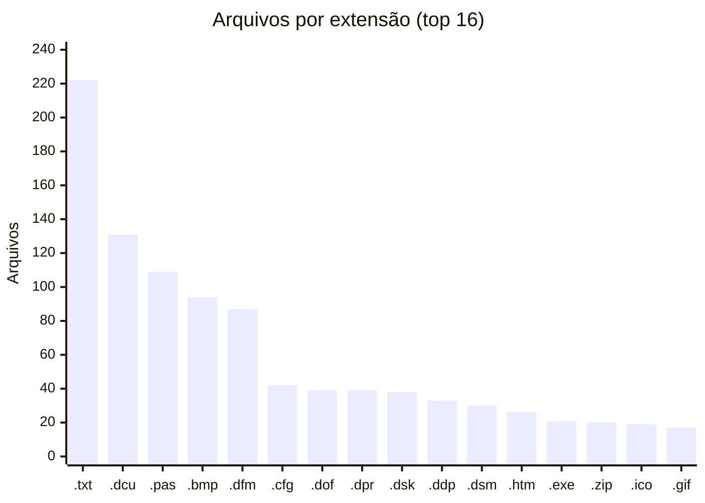

- Os `.txt` são, na maioria, fontes COBOL de exemplo processados pela ferramenta (área `Segur`).
- **131 `.dcu`** (unidades compiladas) e **21 `.exe`** convivem com o código: binários versionados junto do fonte.
- Arquivos de sessão da IDE (`.dsk`, `.ddp`, `.dsm`, `.~*`) somam mais de 100, ruído típico de legado sem
  controle de versão.

### 1.2 Linhas de Pascal por origem

| Origem | Arquivos | Linhas | Código | Comentário | Branco | Formulários | Linhas de form |
|---|---:|---:|---:|---:|---:|---:|---:|
| **Produto** (`Smart/Fon`) | 37 | 30.999 | 23.373 | 1.532 | 6.094 | 32 | 7.931 |
| **Plugins** (`Smart/Dll`) | 47 | 2.765 | 2.082 | 103 | 580 | 23 | 307 |
| **Componentes / forms base** | 9 | 750 | 557 | 59 | 134 | 5 | 92 |
| **Utilitários** (licença, reset) | 4 | 300 | 233 | 4 | 63 | 2 | 375 |
| Cópias e backups | 9 | 5.215 | 3.921 | 245 | 1.049 | 5 | 1.436 |
| Protótipos e testes | 15 | 2.294 | 1.783 | 68 | 443 | 10 | 666 |
| Terceiros (editores, exemplos) | 18 | 5.499 | 4.581 | 215 | 703 | 12 | 5.326 |
| Tradução da VCL | 12 | 1.093 | 872 | 77 | 144 | — | — |
| **Total Pascal** | **151** | **48.915** | **37.402** | **2.303** | **9.210** | **89** | **16.133** |

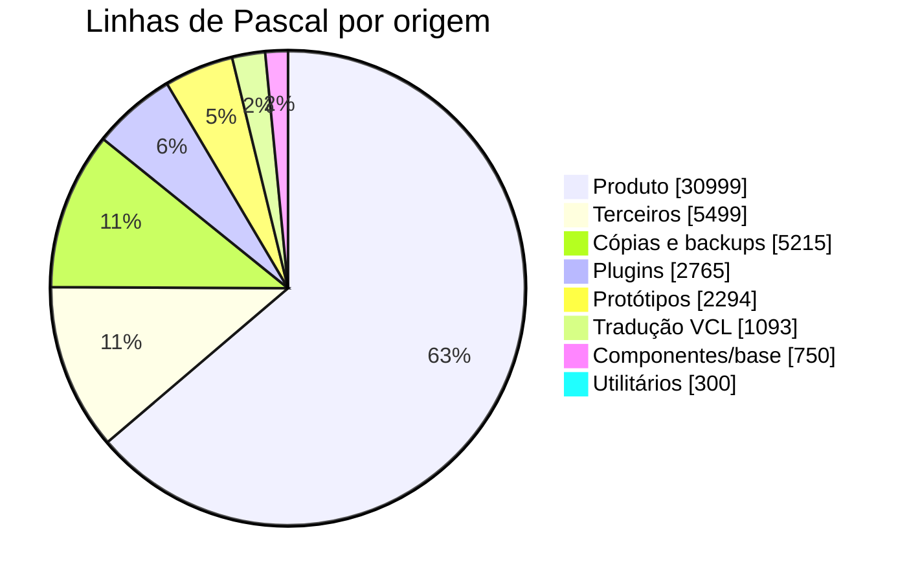

**29% das linhas de Pascal do repositório não são o produto** (cópias, protótipos, terceiros e traduções). Separar
isso é o primeiro passo de qualquer migração.

### 1.3 Composição das linhas próprias

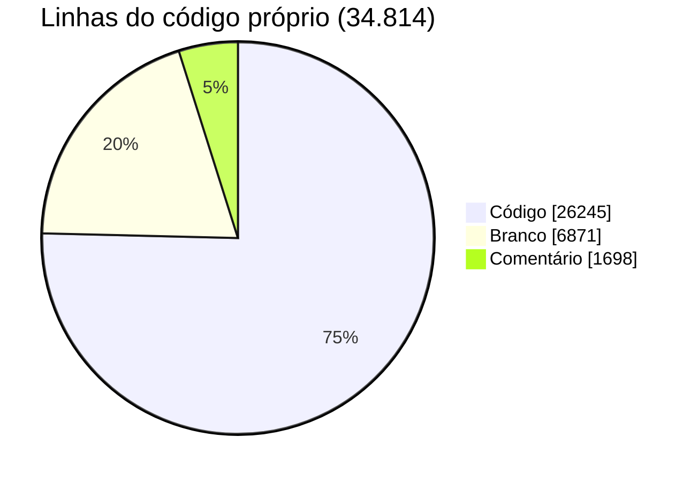

- **Densidade de comentários: 4,9%** (1.698 / 34.814), baixa para um código com tantas regras de negócio.
- **567 linhas de código comentado** (desligado com `//`), 534 delas no produto: funcionalidades e proteções
  desativadas sem registro.

---

## 2. Tamanho dos fontes

### 2.1 Distribuição

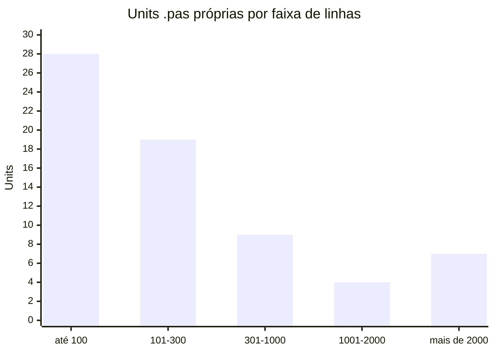

| Escopo | Units | Média | Mediana |
|---|---:|---:|---:|
| Todas as units próprias | 67 | 508 | 147 |
| Produto principal (`Smart/Fon`) | 36 | 856 (646 de código) | 308 |
| Plugins de linguagem | 23 | 97 | — |

A média é puxada para cima por poucos arquivos gigantes; a mediana mostra que a maioria das units é pequena.

### 2.2 Os 10 maiores fontes (67% de todas as linhas próprias)

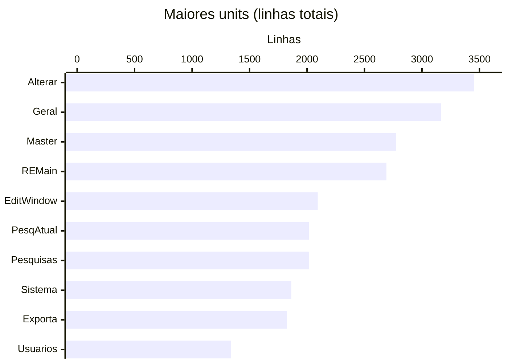

| # | Unit | Linhas | Código | Papel |
|---:|---|---:|---:|---|
| 1 | `Alterar.pas` | 3.454 | 2.676 | Motor de atualização |
| 2 | `Geral.pas` | 3.165 | 2.301 | Biblioteca geral ("god unit") |
| 3 | `Master.pas` | 2.775 | 2.032 | Janela principal e navegação |
| 4 | `REMain.pas` | 2.691 | 2.031 | Livre edição |
| 5 | `EditWindow.pas` | 2.093 | 1.592 | Janela de fonte |
| 6 | `PesqAtual.pas` | 2.016 | 1.528 | Pesquisa e atualização |
| 7 | `Pesquisas.pas` | 2.015 | 1.528 | Pesquisa (cópia adaptada da anterior) |
| 8 | `Sistema.pas` | 1.864 | 1.437 | Cadastro e carga |
| 9 | `Exporta.pas` | 1.824 | 1.267 | Exportação |
| 10 | `Usuarios.pas` | 1.340 | 982 | Usuários e permissões |

---

## 3. Fontes por feature

| Feature | Fontes | Telas | Linhas | Código | Rotinas | CC total | CC média | CC máx. | Rotinas CC > 20 |
|---|---:|---:|---:|---:|---:|---:|---:|---:|---:|
| Pesquisa e atualização | 5 | 5 | 7.853 | 6.023 | 216 | 981 | 4,5 | 49 | 5 |
| Infraestrutura / núcleo | 6 | 1 | 5.862 | 4.358 | 140 | 649 | 4,6 | 33 | 3 |
| Janela principal / navegação | 5 | 5 | 3.245 | 2.387 | 135 | 454 | 3,4 | 28 | 4 |
| Livre edição | 2 | 2 | 2.996 | 2.274 | 74 | 369 | 5,0 | 22 | 2 |
| Plugins de linguagem (DLLs) | 47 | 22 | 2.765 | 2.082 | 101 | 210 | 2,1 | 12 | 0 |
| Cadastro de sistemas e carga | 4 | 4 | 2.306 | 1.783 | 71 | 273 | 3,8 | 30 | 2 |
| Pesquisa | 2 | 2 | 2.157 | 1.640 | 66 | 285 | 4,3 | 26 | 2 |
| Exportação | 2 | 2 | 2.015 | 1.413 | 41 | 197 | 4,8 | **63** | 1 |
| Usuários e vínculos | 2 | 2 | 1.650 | 1.223 | 48 | 213 | 4,4 | 26 | 1 |
| Componentes, forms base, utilitários | 13 | 3 | 1.050 | 790 | 49 | — | — | — | — |
| RollBack | 3 | 2 | 871 | 668 | 27 | 77 | 2,9 | 16 | 0 |
| Sessão e segurança | 3 | 3 | 782 | 579 | 22 | 66 | 3,0 | 11 | 0 |
| Estatísticas | 2 | 2 | 633 | 532 | 21 | 89 | 4,2 | 45 | 1 |
| Parametrização de linguagens | 1 | 1 | 629 | 493 | 18 | 80 | 4,4 | 13 | 0 |

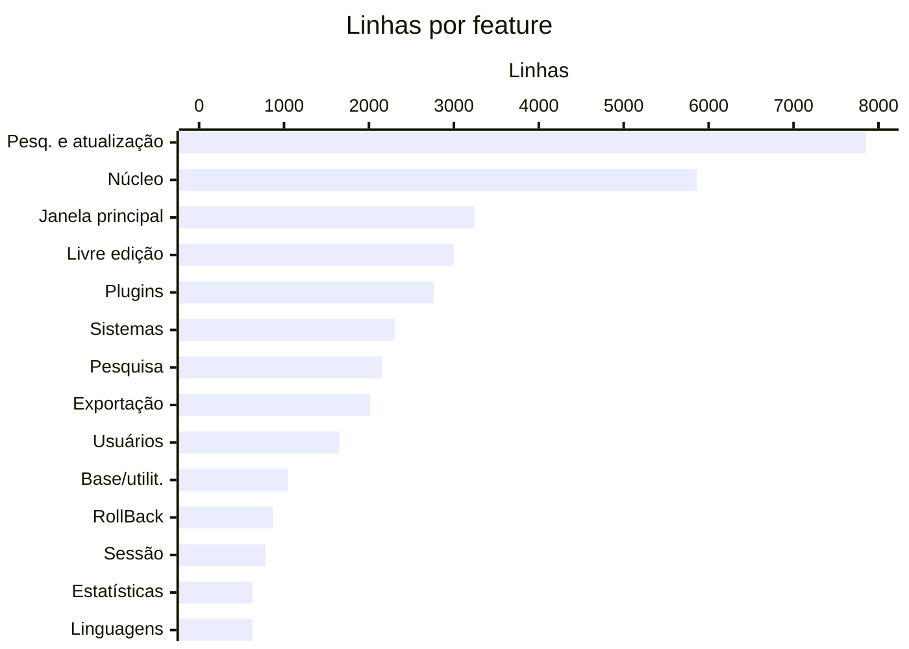

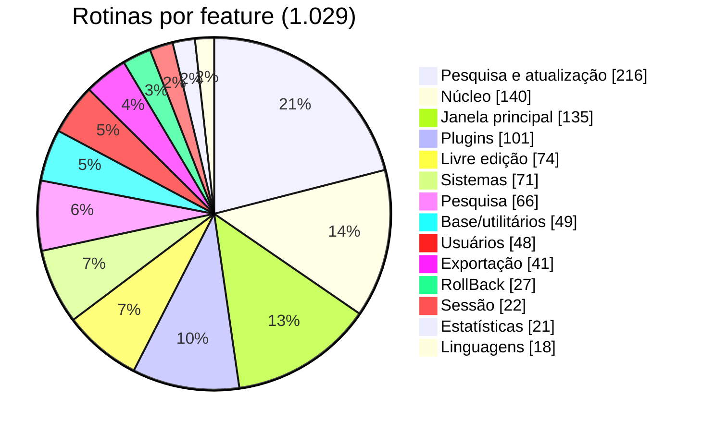

- **O coração do negócio (pesquisa + atualização + edição) concentra 42% do código do produto** e 4 das 12
  rotinas mais complexas.
- O **núcleo** é a segunda maior área, sinal de lógica de domínio misturada em utilitários.
- Os plugins são muitos arquivos, mas pequenos e simples (CC média 2,1): bom candidato a virar configuração.

---

## 4. Telas

| Indicador | Valor |
|---|---:|
| Formulários | 56 (31 produto · 22 plugins · 3 base/utilitários) |
| Componentes visuais (sem módulo de dados) | 701 (média 12,7 por tela) |
| Eventos ligados a código | 420 |
| Componentes no módulo de dados | 130 (11 datasets, 99 campos persistentes) |

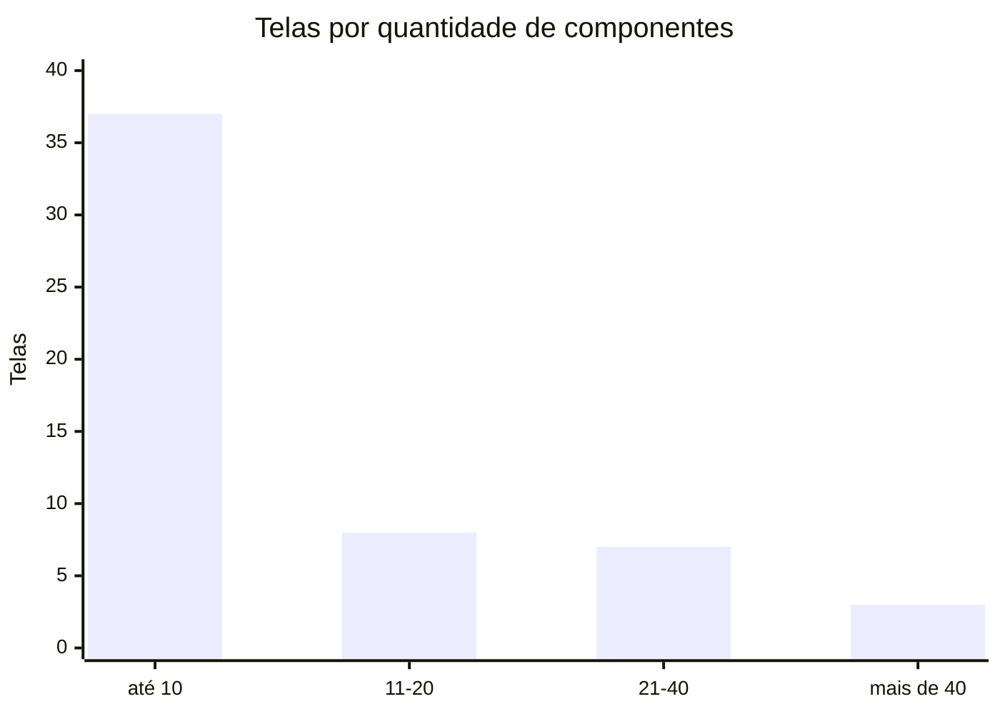

| Tela | Componentes | Eventos |
|---|---:|---:|
| Janela principal (`FMaster`) | 74 | 58 |
| Livre edição (`MainForm`) | 53 | 38 |
| Atualização (`FAlteraFonte`) | 47 | 31 |
| Pesquisa e atualização (`FPesqAtual`) | 37 | 33 |
| Pesquisa (`SFPesquisas`) | 37 | 34 |
| Sistemas (`FSistema`) | 35 | 25 |
| Usuários (`FUsuarios`) | 31 | 31 |

As 22 telas dos plugins herdam de um formulário-base comum e acrescentam de 0 a 13 componentes (a maioria, 3 a 8).

---

## 5. Complexidade

Complexidade ciclomática aproximada por rotina (1 + decisões `if/while/for/repeat/case/and/or/except`).

### 5.1 Níveis

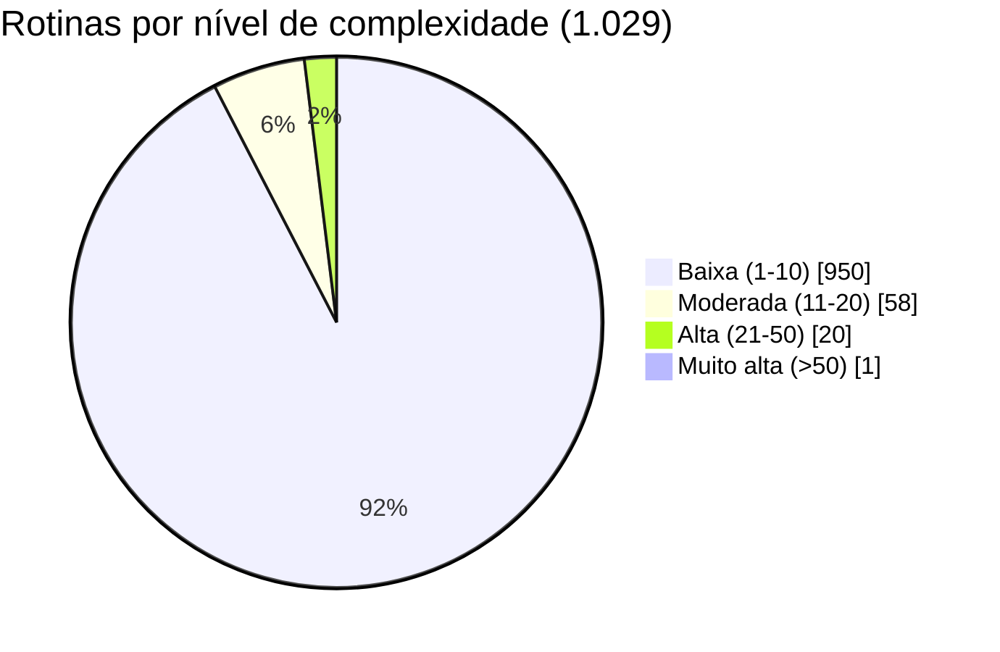

| Nível | Rotinas | % | Interpretação |
|---|---:|---:|---|
| Baixa (1–10) | 950 | 92,3% | Simples, testável |
| Moderada (11–20) | 58 | 5,6% | Atenção em mudanças |
| Alta (21–50) | 20 | 1,9% | Difícil de testar, alto risco de regressão |
| Muito alta (> 50) | 1 | 0,1% | Reescrever com testes de caracterização |

Média **3,9**, mediana **2**, tamanho médio de rotina **23 linhas**. O risco não está na média, e sim na cauda: as 21
rotinas acima de 20 concentram as regras mais críticas.

### 5.2 Rotinas mais complexas

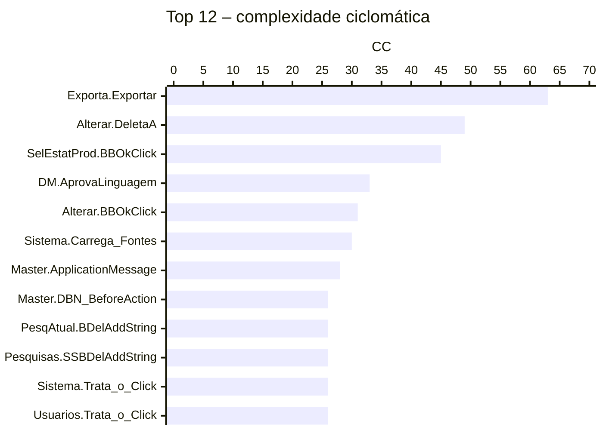

| Rotina | CC | Linhas | O que faz |
|---|---:|---:|---|
| `TFExporta.Exportar` | 63 | 345 | Todo o ciclo de exportação/versão em uma rotina |
| `TFAlteraFonte.DeletaA` | 49 | 278 | Exclusão de linhas com todas as variações |
| `TFSelEstatProd.BBOkClick` | 45 | 185 | Relatório de estatísticas inteiro no clique do botão |
| `TDM_Principal.AprovaLinguagem` | 33 | 149 | Validação da parametrização de linguagem |
| `TFAlteraFonte.BBOkClick` | 31 | 245 | Execução da atualização |
| `TFSistema.Carrega_Fontes` | 30 | 171 | Carga de programas |
| `TFMaster.ApplicationMessage` | 28 | 86 | Interceptação de teclado/mensagens |
| `TFMaster.DBN_PrincipalBeforeAction` | 26 | 81 | Navegação genérica de registros |

**Padrão típico de RAD:** regra de negócio dentro de handlers de evento (`...Click`, `...BeforeAction`).

### 5.3 Complexidade acumulada por arquivo

| Arquivo | Rotinas | CC total | CC máx. |
|---|---:|---:|---:|
| `Alterar.pas` | 72 | 420 | 49 |
| `Master.pas` | 117 | 405 | 28 |
| `Geral.pas` | 91 | 397 | 19 |
| `REMain.pas` | 59 | 328 | 22 |
| `EditWindow.pas` | 76 | 270 | 17 |
| `PesqAtual.pas` | 56 | 268 | 26 |
| `Pesquisas.pas` | 56 | 268 | 26 |
| `Sistema.pas` | 51 | 228 | 30 |

---

## 6. Fontes encadeados (dependências)

Grafo das cláusulas `uses` entre as 36 units do produto principal.

| Indicador | Valor |
|---|---:|
| Arestas (dependências diretas) | 173 |
| Densidade do grafo | 13,7% |
| Maior componente fortemente conectado (ciclo) | **30 units (83%)** |
| Units fora do ciclo | 6 (`Globais`, `FmxUtils`, `FSelecDir`, `PesquisaDlg`, `Sobre`, `aRollBack`) |
| Pares com dependência mútua (A usa B e B usa A) | 32 |

### 6.1 Units mais usadas (fan-in) e que mais usam (fan-out)

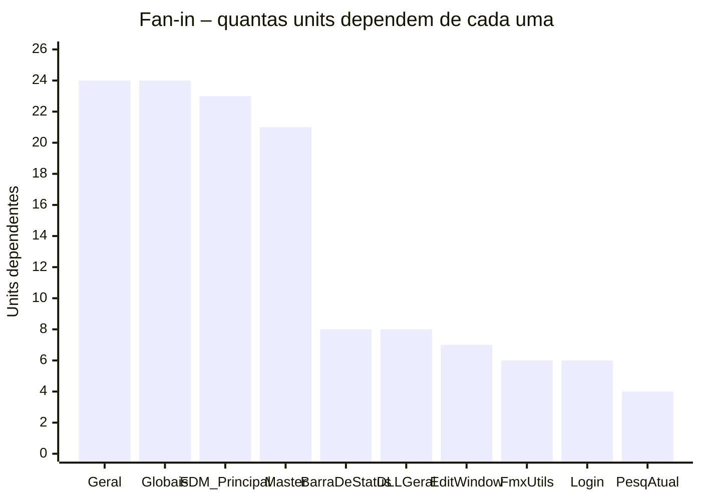

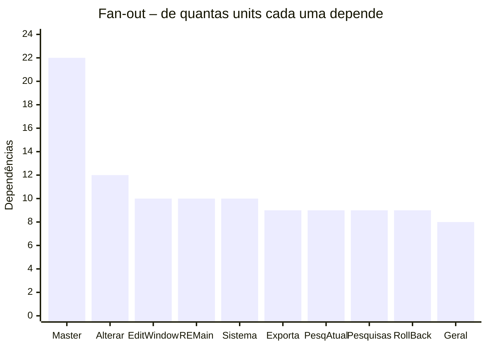

- `Geral`, `Globais`, `FDM_Principal` e `Master` são usados por **2/3 das units**: qualquer mudança neles propaga.
- `Master` é ao mesmo tempo o mais dependente (22) e um dos mais usados (21): é o **hub** do acoplamento.
- `Geral` (biblioteca) depende de `Master` (tela) e do módulo de dados, invertendo as camadas.

### 6.2 Encadeamento entre camadas

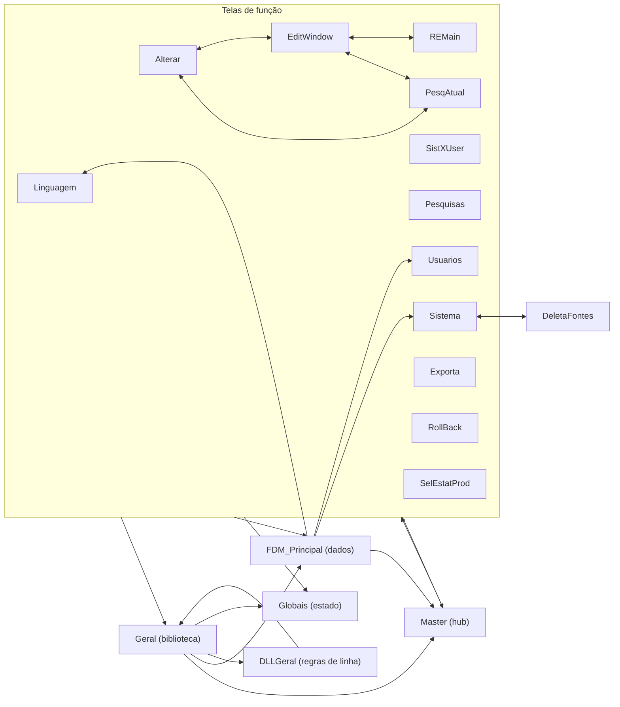

Setas de volta (dados → tela, biblioteca → tela) explicam o ciclo único: **não existe uma unit que possa ser
extraída isoladamente** sem antes quebrar essas dependências.

### 6.3 Encadeamento nos fontes processados (base de exemplo)

A ferramenta também mede o encadeamento dos programas que mantém. Na base de exemplo (sistema COBOL `DEMO1`):

| Indicador | Valor |
|---|---:|
| Programas COBOL na área de trabalho | 21 |
| Linhas | 18.919 (média 901, máx. 1.972) |
| `COPY` (inclusões) | 148, de 2 copybooks (`IDMS` ×145, `Y2KCOPI` ×3) |
| `CALL` (chamadas externas) | 37, para 3 módulos (`ABEND` ×24, `PB003010` ×11, `INTERFA` ×2) |
| Linhas de código citando `ANO` | 185 |
| Versões exportadas para produção | 8 |

O copybook `Y2KCOPI` é a marca direta do trabalho B2k aplicado pela ferramenta.

---

## 7. Duplicação e código órfão

| Comparação | Similaridade (linhas) |
|---|---:|
| `Pesquisas.pas` × `PesqAtual.pas` | **62%** |
| `TextoGrid/REMain.pas` × `REMain.pas` | 50% |
| `Master.pas` × `ConverterBackup/Master.pas` | 100% (só encoding difere) |
| `Usuarios.pas` × `backup/Usuarios.pas` | 100% |

- Pesquisa e Pesquisa+Atualização são **a mesma tela copiada e prefixada com `S`**: 2.015 linhas que poderiam ser
  um componente só.
- 9 arquivos de cópia/backup (5.215 linhas) dentro da árvore de fontes.

### Dependências sem fonte

| Tipo | Quantidade | Itens |
|---|---:|---|
| Units próprias só em `.dcu` | 16 | `MTools`, `TaskBar`, `Aguarde`, `Comandos`, `Cadastra`, `Confirma`, `Entrada`, `Pesquisa`, `PegaLinguagem`, `SelSistemSave`, `SalvaFonte`, `Lzrw1kh`, `demo`, `ArqChart`, `DirBS`, `frmFind` |
| Plugins sem DLL compilada | 21 de 24 | Precisam ser recompilados para a parametrização funcionar |

---

## 8. Indicadores de qualidade

| Indicador | Valor | Observação |
|---|---:|---|
| Variáveis globais em `Globais.pas` | 60 | Estado compartilhado por toda a aplicação |
| Constantes em `Globais.pas` | 133 | Códigos de menu, arquivos, status e instruções |
| Forms criados no startup | 22 | Todos em memória desde o login |
| Mensagens ao usuário (`ShowMessage`/`MessageDlg`) | 246 | Principal fonte de regras de negócio documentadas |
| Caminhos absolutos no código | 23 | Concentrados em `Master`, `REMain`, `RelErros` |
| Blocos `with` | 113 | Dificultam leitura e refatoração automática |
| `Exit` | 297 | Muitos pontos de saída por rotina |
| `try` / `except` | 117 / 54 | 3 `except` vazios (erros engolidos) |
| `Application.ProcessMessages` | 19 | Reentrância de eventos durante processamento |
| SQL montado com `SQL.Add` | 11 | Concatenação de valores |
| Chamadas de trace | 70 | Instrumentação de diagnóstico, desligada por padrão |

---

## 9. Painel de risco por área

| Área | Tamanho | Complexidade | Acoplamento | Duplicação | Risco de mudança |
|---|---|---|---|---|---|
| Pesquisa e atualização | Alto | Alta | Alto | Alta | **Muito alto** |
| Núcleo (`Geral`, `DLLGeral`, dados) | Alto | Média | Muito alto | Baixa | **Muito alto** |
| Janela principal | Médio | Média | Muito alto (hub) | Baixa | **Alto** |
| Exportação | Médio | Muito alta (1 rotina) | Médio | Baixa | **Alto** |
| Livre edição | Médio | Média | Alto | Média | Médio |
| Cadastros (sistemas, usuários) | Médio | Média | Médio | Baixa | Médio |
| Estatísticas | Baixo | Alta (1 rotina) | Baixo | Baixa | Médio |
| Plugins de linguagem | Baixo por arquivo | Baixa | Baixo | Alta (padrão repetido) | **Baixo** |
| Sessão, RollBack, Linguagens | Baixo | Baixa | Médio | Baixa | Baixo |

**Ordem sugerida de ataque:** (1) build reproduzível e remoção de cópias; (2) testes de caracterização sobre a base
COBOL de exemplo; (3) quebrar as dependências reversas do núcleo para a tela; (4) extrair o motor de pesquisa e
atualização; (5) unificar Pesquisa e Pesquisa+Atualização; (6) trocar plugins por configuração.

---

## Metodologia

- **Escopo próprio:** `Smart/Fon` (raiz), `Smart/Dll`, `FormsPadrao`, `Componentes`, `Catalogador`, `ResetaDados`.
  Cópias (`ConverterBackup`, `backup`, "Cópia de…"), protótipos, ferramentas de terceiros e traduções da VCL foram
  medidos à parte. As pastas de documentação (`docs/`, `publico/`) foram excluídas.
- **Linhas:** totais, código, comentário (`//`, `{ }`, `(* *)`, exceto diretivas `{$...}`) e branco; "código
  comentado" = linha `//` contendo `:=`, `;` final, `begin/end` ou `if…then`.
- **Rotinas:** declarações `procedure/function/constructor/destructor` na seção `implementation`.
- **Complexidade:** aproximação de McCabe por contagem léxica de decisões; serve para comparar rotinas entre si,
  não como valor exato.
- **Dependências:** cláusulas `uses` (interface e implementation) entre as units da raiz do produto; ciclos pelo
  algoritmo de Tarjan.
- **Telas:** contagem de componentes e eventos `On*` a partir dos `.dfm/.lfm` (texto e binário).
- **Duplicação:** similaridade de sequência entre linhas não vazias (`difflib`).
- **Fontes de exemplo:** COBOL em `BancoDeDados/Segur/Atual`, ignorando linhas de comentário (coluna 7 = `*`).
